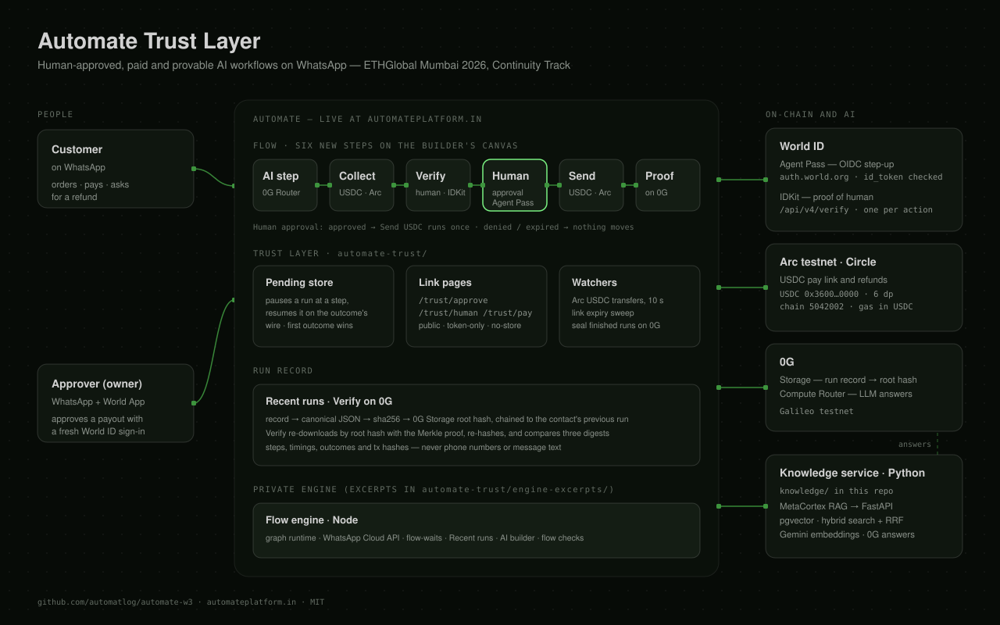
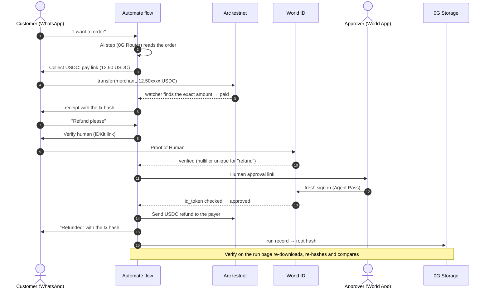

<div align="center">

# Automate Trust Layer

**Human-approved, paid and provable AI workflows, for businesses that already run on WhatsApp.**

[](https://ethglobal.com/events/mumbai)
[](#continuity-before-and-during-the-event)
[](#world-id)
[](#arc-usdc)
[](#0g)
[](LICENSE)

[**Live product: automateplatform.in**](https://automateplatform.in) · [Architecture](#architecture) · [Demo flow](#the-demo-flow) · [Run it](#run-it)

</div>

---

[Automate](https://automateplatform.in) is a live visual workflow builder. Small Indian businesses (restaurants, clinics, D2C shops) use it to let AI agents run their WhatsApp sales and support. Before this weekend, two things still ran on trust:

- **Money.** Payments were manual links and screenshots.
- **Accountability.** Nobody could prove who approved what the AI did, or what a workflow actually ran.

At ETHGlobal Mumbai we added a **trust layer**: six new steps on Automate's canvas, built on World ID, USDC on Arc, and 0G.

| Step | What it does | Built on |
|---|---|---|
| **Human approval** | Pauses the run until a real, verified person approves with a fresh World ID sign-in. **denied** and **expired** mean nothing happens. | World ID **Agent Pass** (OIDC step-up) |
| **Verify human** | The customer proves they are one unique person, so one human gets one refund, whatever number they write from. | World ID **IDKit**, Proof of Human |
| **Collect USDC** | Sends a USDC pay link on WhatsApp. The run continues when the transfer lands on Arc. | **Arc** testnet, USDC |
| **Send USDC** | A refund or payout from the business's Arc wallet. It runs **only** right after an approval, and one approval allows one payment. | **Arc** testnet, USDC |
| **Proof on 0G** | When the run ends, its record goes to 0G Storage. Anyone can re-download it by root hash and check it. | **0G Storage** |
| **AI step / knowledge** | Answers from the business's documents (RAG), with the 0G request id kept on the step. | **0G Compute Router** + the Python knowledge service in this repo |

## Architecture

<p align="center">
  
</p>

- **Pause and resume.** A trust step writes one row (`pending.mjs`), sends its link, and the run stops. The link's page resolves the row: World's id_token or proof is checked, or the USDC transfer is found on Arc. The run then comes back to **the same step**, which takes that outcome's wire. Wires are strict: a missing `denied` wire stops the run instead of falling through to `approved`.
- **Nothing the browser says is an outcome.** Every outcome is verified on the server. The only things a bare link can cause are the safe ones: deny and cancel.
- **The public record holds no personal data.** 0G Storage is public, so the record keeps the steps, timings, outcomes and transaction hashes, and never message text or phone numbers. The contact is an HMAC. Each sealed run points at the contact's previous root, so a conversation forms a chain.

## The demo flow



**The failure paths are part of the demo:**
- An approval that is **denied** or **expired** sends no refund.
- A second refund claim from the **same human** is refused, even from another number.
- A **second Send USDC** without a new approval is refused, and nothing is signed.

## World ID

**Agent Pass: the Human approval step** ([`world.mjs`](automate-trust/server/lib/trust/world.mjs), [`routes.mjs`](automate-trust/server/lib/trust/routes.mjs))

- **The full journey.** The flow pauses, then the approver gets the link and signs in at `auth.world.org` (authorization code with PKCE S256, `prompt=login`, `max_age=300`). The server exchanges the code and checks the id_token against World's JWKS: signature, `iss`, `aud`, `nonce`, `exp`, and that `auth_time` is fresh. Only then does the protected step (Send USDC) run.
- **Approver binding.** The first approver to sign in is bound to the account (by pairwise `sub`). A different World ID cannot approve later.
- **The unsuccessful path.** Denied, expired, a cancelled sign-in or a wrong approver all mean Send USDC never runs. The engine enforces this too: Send USDC refuses unless an approval came back `approved` in the last 15 minutes, and that approval is spent by it.
- **Secrets stay on the server.** The client secret is server-side only. The approval page is `no-store` and sends no Referer.

**IDKit: the Verify human step**

- **The trust moment.** A refund claim. **Proof of Human** is the minimum credential that stops one person claiming many refunds from many numbers; a passport or a selfie check would ask for more than the moment needs.
- **How it is checked.**
  - The server signs the RP request (`signRequest`, so the signing key never reaches the browser).
  - The browser runs `IDKit.request(...).preset(proofOfHuman(...))`.
  - The server verifies with `POST /api/v4/verify/{rp_id}`, rejects the wrong `environment` before calling World, and stores the nullifier uniquely per action.
- **Other paths.** **already** (this person already claimed) and **cancelled** (they cancelled, or the link expired).

## Arc (USDC)

[`arc.mjs`](automate-trust/server/lib/trust/arc.mjs)

- **Collect.**
  - Each pay link asks for a **unique amount**: the price plus a 1 to 9,999 micro-USDC tag.
  - A watcher reads `Transfer` logs to the merchant on Arc testnet (chain `5042002`) and matches the exact amount. A transaction hash is never matched twice.
  - The pay page switches or adds Arc in the wallet and sends the ERC-20 `transfer`. It also shows an EIP-681 QR code.
- **Send.**
  - An ERC-20 `transfer` from the server wallet, signed with ethers and confirmed before the flow moves on.
  - It is bounded by `ARC_MAX_SEND_USDC`, and it runs only after an approval.
- **Escrow: TrustEscrow, built in Arc Studio** ([`arc-escrow/`](arc-escrow), [Studio project](https://studio.arc.io/app/7870ac8f-cc09-46d8-8dc0-370f0dc9fc2a)).
  - Deployed on Arc testnet at [`0xa20fca1ed130da973f4d6213e2487534b1d1b1a2`](https://explorer.testnet.arc.io/address/0xa20fca1ed130da973f4d6213e2487534b1d1b1a2), with 65 Foundry tests.
  - It holds USDC per order. Only Automate's operator can `release` or `refund`.
  - `pay` needs the operator's signature over `(chainid, contract, orderId, amount, deadline)`, so only the exact quoted amount can be paid.
  - The payer can `reclaim` after 14 days, so a customer's money is never stuck.
  - Arc Studio wrote, reviewed, tested and deployed it from our spec. We chose the signature fix after its review found order-ID squatting.
- **Units.** USDC on Arc has 6 decimals through the ERC-20 interface (`0x3600…0000`) and 18 as the native gas token. All amount maths is exact string arithmetic, with no floats.

## 0G

- **Storage: the Proof on 0G step** ([`zg.mjs`](automate-trust/server/lib/trust/zg.mjs)).
  - When a run that passed this step ends, its record is turned into **canonical JSON** (keys sorted), hashed with sha256, and uploaded with the 0G TS SDK. The run keeps the root hash, the tx and the digest.
  - **Verify** downloads the record by root hash with the Merkle proof and compares three digests: the downloaded one, the one stored at sealing, and the record rebuilt from the run now. So a changed upload *and* a run edited afterwards both show.
- **Compute Router.** Automate's AI step can run on `router-api.0g.ai` ([`zg-router.mjs`](automate-trust/server/lib/trust/zg-router.mjs)), and so can the knowledge service ([`knowledge/llm.py`](knowledge/llm.py)). Both keep the Router's `x_0g_trace.request_id`, and the AI step's request id goes into the run's record on 0G, so a sealed run says which 0G request produced its AI output.

## Knowledge service (Python)

[`knowledge/`](knowledge) is a FastAPI service ported from the author's earlier **MetaCortex** RAG project. It stands in for Automate's private Node server, which stays private.

| | |
|---|---|
| Ingest | text, PDF, TXT, CSV → sanitised, chunked (700 / 120), PII masked before anything reaches a model |
| Embeddings | any OpenAI-compatible `/embeddings` (default Gemini `gemini-embedding-001`) |
| Store | Postgres + pgvector, one collection per knowledge base, plus a tsvector table for keyword search |
| Retrieval | hybrid: vector and keyword in parallel, fused with reciprocal rank fusion |
| Answer | 0G Compute Router, with the request id returned |

Details: [`knowledge/README.md`](knowledge/README.md).

## Run it

**Trust layer (Node ≥ 22).** The tests are offline: World, Arc and 0G are faked, and the tests fail if anything real is reached.

```bash
cd automate-trust
npm install
npm test        # World ID: 71 checks · Arc USDC: 81 checks
```

**Knowledge service (Python 3.12).**

```bash
docker compose up -d                                  # pgvector on :5433
python -m venv .venv && .venv/Scripts/pip install -r requirements.txt
pytest                                                # 31 tests, offline
uvicorn knowledge.app:app --port 8000
```

**Configuration.** Names only, with no values; see [`.env.example`](.env.example).

| Variable | For |
|---|---|
| `WORLD_OIDC_CLIENT_ID`, `WORLD_OIDC_CLIENT_SECRET` | Agent Pass (auth.world.org portal) |
| `WORLD_APP_ID`, `WORLD_RP_ID`, `WORLD_SIGNING_KEY`, `WORLD_ENV` | IDKit (Developer Portal) |
| `ARC_PRIVATE_KEY`, `ARC_MERCHANT_ADDRESS`, `ARC_MAX_SEND_USDC` | Arc testnet wallet |
| `ZG_PRIVATE_KEY` | 0G Storage uploads (Galileo testnet) |
| `LLM_API_KEY`, `EMBEDDING_API_KEY`, `DATABASE_URL` | knowledge service |
| `TRUST_BASE_URL` | where the link pages are served |

## Tests

| Suite | Checks | What it covers |
|---|---|---|
| `automate-trust/scripts/test-trust-world.mjs` | 71 | PKCE, nonce, state, id_token signature and claims, stale `auth_time`, approver binding, IDKit verify bound to this request (nonce, action, signal), duplicate nullifiers, the environment check, HTML escaping, no secret in any output |
| `automate-trust/scripts/test-trust-arc.mjs` | 81 | exact unit maths, unique amounts, log matching (wrong amount, wrong recipient, replayed tx), block windows, send limits, the decoded raw transaction |
| `engine-excerpts/test-trust-flow.mjs` | 42 | the whole demo flow through Automate's real engine: paid, verified, approved, a real signed refund, the second refund refused, denied / expired / half-wired, forged callbacks, the 0G record's privacy, seal and verify, and the AI step on the 0G Router. It runs inside Automate's repo |
| `tests/` (pytest) | 31 | chunking, PII, RRF, retrieval, embeddings batching, the 0G request id, the API routes, auth |

## Repository layout

```
automate-trust/
  server/lib/trust/
    pending.mjs     pause a run at a step, resume it on the outcome's wire
    world.mjs       Agent Pass (OIDC step-up) + IDKit proof of human + the two pages
    arc.mjs         USDC pay links, the payment watcher, refunds + the pay page
    zg.mjs          canonical run record, seal on 0G Storage, verify
    zg-router.mjs   the AI step on the 0G Compute Router, keeping the request id
    routes.mjs      the public link pages
  scripts/          offline tests for world.mjs and arc.mjs
  engine-excerpts/  the parts of Automate's private engine that host the steps
arc-escrow/         TrustEscrow contract, tests and pay page, built in Arc Studio
knowledge/          Python RAG service (FastAPI, pgvector, 0G Router)
  metacortex_original/  the pre-existing files it was ported from, unchanged
docs/
  architecture.svg
  ai-usage.md
  ethglobal/        the prize research and implementation plan used this weekend
```

## What's next

- Make Human approval the default before every payout and bulk send in Automate.
- Run Arc Nanopayments and x402 for agent-to-agent payments.
- Add a public "verify this run" page that needs no Automate account.
- Move to mainnet once a business asks for it.

## License

[MIT](LICENSE). Built by [Aman Yadav](https://automatlog.in) · Smart Technology.
